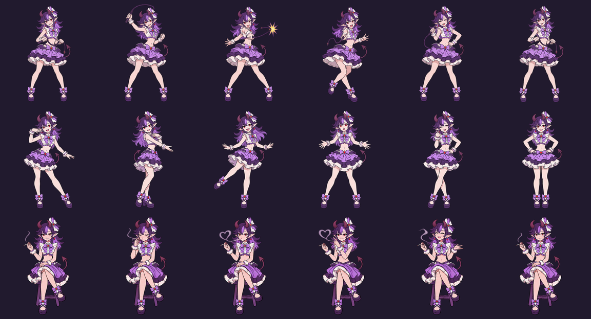

# Веспера для Windows

Веспера — прозрачный оверлей Windows, который реагирует на печать, прокрутку и простой. Скачай архив для Windows x64 со страницы [Releases](../../releases), распакуй его и запусти `Vespera.exe`. Удлинённые сцены доступны в [предрелизе 1.1.0-rc.1](../../releases/tag/v1.1.0-rc.1). Параметры и выход находятся в меню значка «Веспера» рядом с часами. Через меню можно показать сцену вручную, запустить демонстрацию и изменить размер.

Чтобы передвинуть Весперу, зажми Alt, возьми её левой кнопкой и потяни. Она перебирает ногами и меняет направление при движении влево и вправо. Если остановить мышь на месте, она остановится. В меню есть режим «Перетаскивать без Alt». В обычном режиме клики проходят сквозь оверлей.

| Активность | Что делает Веспера |
| --- | --- |
| Печать в любом приложении | Веспера делает два щелчка плетью и завершает сцену танцевальным шагом. После паузы в печати заканчивает начатую сцену. |
| Прокрутка колёсиком | Следит за физическим указателем. Этот короткий режим имеет приоритет над сценой печати. |
| Пауза после серии печати | После сцены с плетью один раз исполняет танец айдола с поворотом, шагом и финальным жестом. Новая печать или прокрутка прерывает танец. Вручную — «Показать сцену» → «Танец айдола». |
| 5,5 секунды без ввода | Садится, скрещивает ноги, выдыхает дым сердечком и пробует обвести след пальцем. Посадка проигрывается один раз, потом повторяется цикл с дымом. Начатое выступление сначала доигрывается. |
| Другое действие | Возвращается в спокойную позу. |

Оверлей запускается без Codex. По умолчанию плеть и танец реагируют на печать в любом приложении. Сними галочку «Реагировать на печать во всех приложениях» в меню рядом с часами, чтобы на время ограничить реакции окном Codex. Для постоянного ограничения установи `typingInAllApps` в `false` в файле настроек. Прокрутка по умолчанию определяется по событиям колеса Windows. Жесты отдельных моделей тачпадов могут не посылать такие события.

Оверлей использует сведения Windows о типе события, последней активности и положении указателя. Он отдельно проверяет, удерживается ли Alt, для режима перетаскивания. Содержимое клавиатурного события, текст, буфер обмена и скриншоты не читаются. Сетевые запросы, история ввода и запись в настройки Codex отсутствуют.

В папке `artwork` рядом с исполняемым файлом находится `pack.json`. В нём перечислены PNG каждой сцены и время кадра в миллисекундах. `loopFrom` задаёт индекс кадра, с которого начинается повтор после вступления. Количество файлов и их разрешение не привязаны к сетке Codex. Кадры имеют разрешение 576×624 и собраны из исходных иллюстраций. В `artwork/activity.json` можно изменить задержку перекура, реакцию на печать и прокрутку, порог серии печати для танца и начальный размер окна. Изменения вступают в силу после повторного запуска.

Для сборки из исходников на Windows нужен .NET 10 SDK. Выполни `dotnet publish -c Release -o release` и запусти `release/Vespera.exe`. Команда `release/Vespera.exe --check` проверяет пакет кадров и правила переключения сцен. Для демонстрации автоматических реакций используй `release/Vespera.exe --demo`.
